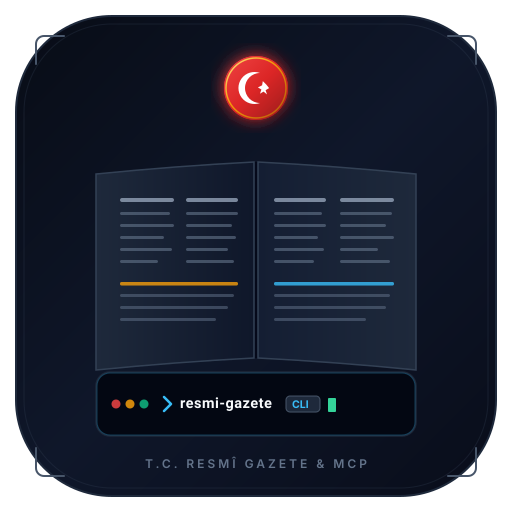
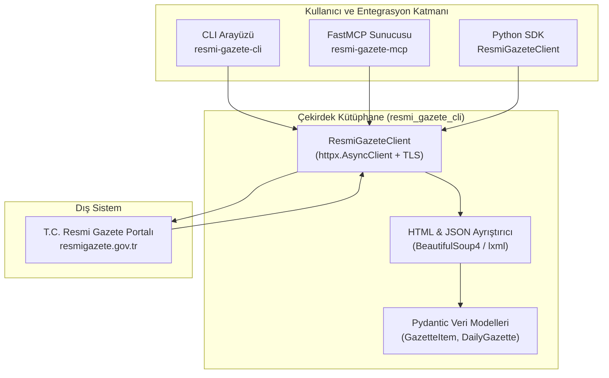

<div align="center">
  
  <h1>Resmi Gazete CLI</h1>

  <p>
    <b>T.C. Resmi Gazete için Asenkron Python SDK, CLI ve FastMCP Sunucusu</b>
  </p>

  <p>
    <a href="https://pypi.org/project/resmi-gazete-cli/">
      
    </a>
    <a href="https://pypi.org/project/resmi-gazete-cli/">
      
    </a>
    <a href="https://github.com/AtaCanYmc/resmi-gazete-cli/actions/workflows/release-please.yml">
      
    </a>
    <a href="https://github.com/AtaCanYmc/resmi-gazete-cli/actions/workflows/ci.yml">
      
    </a>
    <a href="https://pypi.org/user/atacanymc/">
      
    </a>
    <a href="LICENSE">
      
    </a>
  </p>
</div>

---

## İçindekiler

- [Genel Bakış](#genel-bakış)
- [Dokümantasyon](#dokümantasyon)
- [Mimari](#mimari)
- [Kurulum](#kurulum)
- [Hızlı Başlangıç](#hızlı-başlangıç)
- [Kullanım](#kullanım)
  - [1. Komut Satırı Arayüzü (CLI)](#1-komut-satırı-arayüzü-cli)
  - [2. Model Context Protocol (MCP) Sunucusu](#2-model-context-protocol-mcp-sunucusu)
  - [3. Python Kütüphanesi Olarak Kullanım](#3-python-kütüphanesi-olarak-kullanım)
- [Proje Dizini Yapısı](#proje-dizini-yapısı)
- [Geliştirme ve Test](#geliştirme-ve-test)
- [Sıkça Sorulan Sorular (SSS)](#sıkça-sorulan-sorular-sss)
- [Lisans](#lisans)

---

## Genel Bakış

`resmi-gazete-cli`, T.C. Resmi Gazete (`resmigazete.gov.tr`) üzerinde yayımlanan kararları, kanunları, yönetmelikleri ve ilanları terminal üzerinden sorgulamak ve LLM ajanlarına aktarmak üzere tasarlanmış asenkron bir araç setidir.

Üç temel arabirim sunar:

1. **Python SDK:** `httpx` ve `pydantic` tabanlı, TLS doğrulamalı asenkron HTTP istemcisi.
2. **Terminal Arayüzü (CLI):** `click` ve `rich` tabanlı, formatlanmış konsol çıktısı veren komut satırı aracı.
3. **Model Context Protocol (MCP) Sunucusu:** LLM ajanlarının (Claude Desktop, Cursor vb.) günün gazetesini ve geçmiş sayıları doğrudan sorgulayabilmesini sağlayan `FastMCP` stdio sunucusu.

---

## Dokümantasyon

Detaylı kullanım ve entegrasyon kılavuzları `docs/` dizini altında toplanmıştır:

| Doküman | Kapsam |
| --- | --- |
| [Genel Mimari ve Giriş](docs/index.md) | Sistem mimarisi, veri akış diyagramı ve genel yetenekler. |
| [CLI Kullanım Kılavuzu](docs/cli.md) | `daily` ve `search` komutları, tüm parametreler, kısayollar ve çıkış kodları. |
| [Model Context Protocol (MCP)](docs/mcp.md) | FastMCP araçları, Claude Desktop, Cursor ve VS Code yapılandırma rehberi. |
| [Python SDK & API Referansı](docs/sdk.md) | `ResmiGazeteClient` API'si, Pydantic modelleri ve asenkron kod tarifleri. |

---

## Mimari

Sistem bileşenleri ve katmanlar arası veri akışı aşağıdaki şemada gösterilmiştir:



---

## Kurulum

### 1. PyPI Üzerinden Kurulum (Önerilen)

Paketi doğrudan [PyPI](https://pypi.org/project/resmi-gazete-cli/) üzerinden yükleyebilirsiniz:

```bash
pip install resmi-gazete-cli
```

İzole bir CLI aracı olarak çalıştırmak için `uv` veya `pipx` kullanabilirsiniz:

```bash
# uv ile
uv tool install resmi-gazete-cli

# veya pipx ile
pipx install resmi-gazete-cli
```

### 2. Kaynak Koddan Kurulum (Geliştirici Modu)

Projeye katkı sağlamak veya yerel olarak derlemek için:

```bash
# Depoyu klonlayın
git clone https://github.com/AtaCanYmc/resmi-gazete-cli.git
cd resmi-gazete-cli

# Sanal ortamı hazırlayın
python3 -m venv .venv
source .venv/bin/activate  # Windows: .venv\Scripts\activate

# Bağımlılıkları yükleyin
pip install --upgrade pip
pip install -e .
```

---

## Hızlı Başlangıç

Kurulum tamamlandıktan sonra CLI sürümünü kontrol edin:

```bash
resmi-gazete-cli --version
```

---

## Kullanım

### 1. Komut Satırı Arayüzü (CLI)

#### Günlük Resmi Gazete (`daily`)

```bash
# Günün sayısını formatlanmış tablo olarak listele
resmi-gazete-cli daily

# Belirli bir tarihteki sayıyı listele (GG.AA.YYYY veya YYYY-MM-DD)
resmi-gazete-cli daily -d 17.11.2026

# Mükerrer sayıyı listele
resmi-gazete-cli daily -d 2026-10-27 -m 1

# Kategoriye göre filtrele (örn. Cumhurbaşkanı, Yönetmelik, Tebliğ, İlan)
resmi-gazete-cli daily -c "Yönetmelik"

# Çıktıyı JSON formatında al
resmi-gazete-cli daily -j
```

#### Arşiv ve Detaylı Arama (`search`)

```bash
# Anahtar kelime ile arama yap
resmi-gazete-cli search -k "vergi"

# Tarih aralığı ve mevzuat türü ile arama yap (kanun, teblig, yonetmelik, cb-karar, aym)
resmi-gazete-cli search -k "vergi" -t "teblig" -b 01.11.2026 -e 15.11.2026

# Resmi Gazete sayısına göre ara
resmi-gazete-cli search -s 33434

# Çıktıyı Markdown formatında al
resmi-gazete-cli search -k "yapay zeka" --format md

# Çıktıyı JSON formatında al
resmi-gazete-cli search -k "kvkk" --format json -l 20
```

### 2. Model Context Protocol (MCP) Sunucusu

Proje, LLM ajanlarının (Claude Desktop, Cursor, Windsurf, Cline vb.) Resmi Gazete verilerine canlı erişebilmesi için `FastMCP` stdio sunucusu içerir.

#### Sunulan MCP Araçları (Tools)

| Araç Adı | Açıklama | Temel Parametreler |
| --- | --- | --- |
| `get_todays_gazette` | Güncel Resmi Gazete özetini, bölüm başlıklarını ve madde linklerini listeler. | Parametresiz |
| `get_gazette_by_date` | Belirli bir tarihteki Resmi Gazete sayısını listeler. | `tarih` (GG.AA.YYYY veya YYYY-MM-DD), `mukerrer` (opsiyonel) |
| `search_gazette` | Arşivde anahtar kelime, tarih aralığı, sayı ve mevzuat türüyle parametrik arama yapar. | `kelime`, `baslangic_tarihi`, `bitis_tarihi`, `sayi`, `mevzuat_turu`, `page` |
| `get_document_content` | Karar veya yönetmeliğin metin içeriğini indirip temizler. | `url` (dokümanın web bağlantısı) |

#### Claude Desktop Entegrasyonu

Claude Desktop yapılandırma dosyanıza aşağıdaki bloğu ekleyin:

- **macOS:** `~/Library/Application Support/Claude/claude_desktop_config.json`
- **Windows:** `%APPDATA%\Claude\claude_desktop_config.json`

```json
{
  "mcpServers": {
    "resmi-gazete": {
      "command": "resmi-gazete-mcp"
    }
  }
}
```

Sanal ortam ile çalıştırmak isterseniz mutlak python yolunu belirtin:

```json
{
  "mcpServers": {
    "resmi-gazete": {
      "command": "/Users/KULLANICI_ADI/PycharmProjects/resmi-gazete-cli/.venv/bin/python",
      "args": ["-m", "resmi_gazete_cli.mcp.server"]
    }
  }
}
```

#### Cursor Entegrasyonu

1. Cursor ayarlarını açın: **Settings > Features > MCP**.
2. **Add New MCP Server** butonuna tıklayın.
3. Bilgileri girin:
   - **Name:** `resmi-gazete`
   - **Type:** `command`
   - **Command:** `resmi-gazete-mcp` (veya sanal ortam yolu: `/path/to/.venv/bin/resmi-gazete-mcp`)
4. Sunucuyu kaydedip yeşil durum ışığını doğrulayın. Cursor Agent veya Composer içinde *"Günün Resmi Gazete kararlarını getir"* veya *"Vergi Usul Kanunu tebliğlerini ara"* komutlarını verebilirsiniz.

#### VS Code (Cline / Roo Code) Entegrasyonu

`cline_mcp_settings.json` içerisine ekleyin:

```json
{
  "mcpServers": {
    "resmi-gazete": {
      "command": "resmi-gazete-mcp",
      "disabled": false,
      "autoApprove": [
        "get_todays_gazette",
        "get_gazette_by_date",
        "search_gazette",
        "get_document_content"
      ]
    }
  }
}
```

### 3. Python Kütüphanesi Olarak Kullanım

`ResmiGazeteClient` sınıfını doğrudan asenkron Python projelerinizde kullanabilirsiniz:

```python
import asyncio
from resmi_gazete_cli import ResmiGazeteClient


async def main():
    async with ResmiGazeteClient() as client:
        gazette = await client.get_todays_gazette()
        print(f"Tarih: {gazette.date}, Sayı: {gazette.number}")

        for category in gazette.categories:
            print(f"\n## {category.main_category}")
            for item in category.items:
                print(f"  - {item.title} -> {item.url}")


if __name__ == "__main__":
    asyncio.run(main())
```

---

## Proje Dizini Yapısı

```text
resmi-gazete-cli/
├── pyproject.toml                     # Hatchling derleme ve bağımlılık manifestosu
├── Makefile                           # Test, lint ve derleme otomasyon görevleri
├── README.md                          # Temel dokümantasyon ve vitrin
├── CONTRIBUTING.md                    # Geliştirici katkı kuralları
├── SECURITY.md                        # Güvenlik politikası ve bildirim SLA'sı
├── ROADMAP.md                         # Sürüm kilometre taşları
├── LICENSE                            # Apache-2.0 lisans metni
├── .editorconfig                      # Evrensel editör biçimlendirme kuralları
├── .gitattributes                     # Satır sonu (LF) ve ikili dosya kuralları
├── .markdownlint.json                 # Markdown linter yapılandırması
├── .flake8                            # Python linter kuralları
├── release-please-config.json         # Otomatik sürümleme yapılandırması
├── .release-please-manifest.json      # Sürüm takip manifestosu
├── docs/                              # Detaylı teknik kılavuzlar
│   ├── index.md                       # Dokümantasyon indeksi ve sistem mimarisi
│   ├── cli.md                         # CLI komut referansı (daily, search)
│   ├── mcp.md                         # Model Context Protocol ve LLM entegrasyonu
│   ├── sdk.md                         # Python SDK referansı ve modeller
│   └── assets/
│       └── logo.svg                   # Vektörel kurumsal logo
├── .github/
│   ├── CODEOWNERS                     # PR otomatik denetçi atamaları
│   ├── dependabot.yml                 # Bağımlılık güncelleme planlayıcısı
│   ├── ISSUE_TEMPLATE/                # Hata ve özellik talep şablonları
│   ├── PULL_REQUEST_TEMPLATE/         # PR kontrol listesi şablonu
│   └── workflows/
│       ├── ci.yml                     # Otomatik test ve derleme iş akışı
│       └── release-please.yml         # Sürüm ve etiket otomasyonu
├── resmi_gazete_cli/
│   ├── __init__.py                    # Paket dışa aktarımları ve sürüm sabiti
│   ├── scraper/
│   │   ├── __init__.py
│   │   ├── client.py                  # HTTP istemcisi ve hata yönetimi
│   │   ├── models.py                  # Pydantic veri modelleri
│   │   ├── parser.py                  # HTML gazete ayrıştırıcısı
│   │   └── security.py                # SSRF ve URL doğrulama güvenlik kontrolleri
│   ├── cli/
│   │   ├── __init__.py
│   │   └── main.py                    # Click terminal komutları
│   └── mcp/
│       ├── __init__.py
│       └── server.py                  # FastMCP stdio sunucusu
└── tests/
    ├── __init__.py
    ├── test_cli.py                    # CLI komut testleri
    ├── test_client.py                 # İstemci ve HTTP mock testleri
    ├── test_mcp.py                    # FastMCP araç testleri
    ├── test_models.py                 # Pydantic model doğrulama testleri
    ├── test_parser.py                 # HTML parser ve normalizasyon testleri
    └── test_security.py               # SSRF, DoS ve enjeksiyon güvenlik testleri
```

---

## Geliştirme ve Test

Geliştirici ortamında testleri ve kod stili kontrollerini çalıştırmak için:

```bash
# Linter kontrolü
flake8 . --count --select=E9,F63,F7,F82 --show-source --statistics

# Testleri çalıştırın
pytest
```

---

## Sıkça Sorulan Sorular (SSS)

### Resmi Gazete sunucusu istekleri engelliyor mu?
Hedef sistem `resmigazete.gov.tr`, belirli bir frekansın üzerindeki isteklerde veya geçersiz `User-Agent` başlıklarında bağlantıyı reddedebilir. `ResmiGazeteClient` varsayılan olarak gerçekçi tarayıcı başlıkları kullanır ve yeniden deneme/zaman aşımı yönetimini destekler.

### Bu araç resmi bir kamu projesi midir?
Hayır. Bu araç bağımsız bir açık kaynak projesidir ve T.C. Cumhurbaşkanlığı İdari İşler Başkanlığı ya da Resmi Gazete kurumu ile doğrudan resmi bir bağı bulunmamaktadır.

### Karar ve ilan metinleri çevrimdışı önbelleğe alınıyor mu?
Varsayılan istemci canlı HTTP sorguları yapar. Ağ trafiğini optimize etmek veya toplu analiz gerçekleştirmek isteyen kullanıcılar dönen `GazetteItem` modellerini yerel SQLite ya da dosya sistemine kaydedebilir.

---

## Lisans

Bu proje [Apache-2.0](LICENSE) lisansı ile dağıtılmaktadır.
