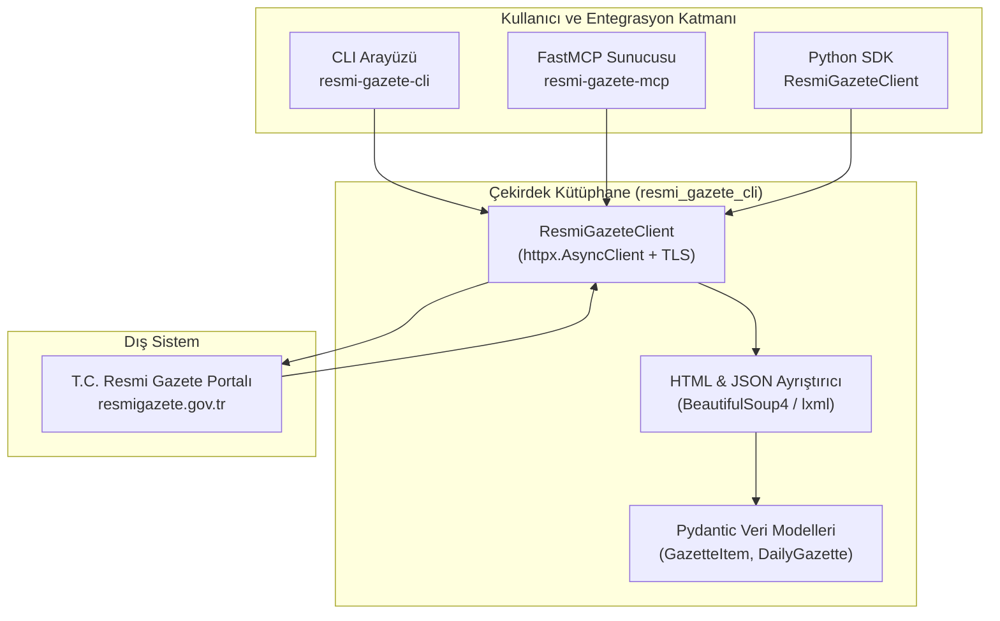

<div align="center">
  <h1>Resmi Gazete CLI</h1>

  <p>
    <b>T.C. Resmi Gazete için Asenkron Python SDK, CLI ve FastMCP Sunucusu</b>
  </p>

  <p>
    <a href="https://github.com/AtaCanYmc/resmi-gazete-cli/actions/workflows/ci.yml">
      
    </a>
    <a href="https://pypi.org/project/resmi-gazete-cli/">
      
    </a>
    <a href="LICENSE">
      
    </a>
  </p>
</div>

---

## İçindekiler

- [Genel Bakış](#genel-bakış)
- [Mimari](#mimari)
- [Kurulum](#kurulum)
- [Hızlı Başlangıç](#hızlı-başlangıç)
- [Kullanım](#kullanım)
  - [1. Komut Satırı Arayüzü (CLI)](#1-komut-satırı-arayüzü-cli)
  - [2. Model Context Protocol (MCP) Sunucusu](#2-model-context-protocol-mcp-sunucusu)
  - [3. Python Kütüphanesi Olarak Kullanım](#3-python-kütüphanesi-olarak-kullanım)
- [Proje Dizini Yapısı](#proje-dizini-yapısı)
- [Geliştirme ve Test](#geliştirme-ve-test)
- [Sıkça Sorulan Sorular (SSS)](#sıkça-sorulan-sorular-sss)
- [Lisans](#lisans)

---

## Genel Bakış

`resmi-gazete-cli`, T.C. Resmi Gazete (`resmigazete.gov.tr`) üzerinde yayımlanan kararları, kanunları, yönetmelikleri ve ilanları terminal üzerinden sorgulamak ve LLM ajanlarına aktarmak üzere tasarlanmış asenkron bir araç setidir.

Üç temel arabirim sunar:

1. **Python SDK:** `httpx` ve `pydantic` tabanlı, TLS doğrulamalı asenkron HTTP istemcisi.
2. **Terminal Arayüzü (CLI):** `click` ve `rich` tabanlı, formatlanmış konsol çıktısı veren komut satırı aracı.
3. **Model Context Protocol (MCP) Sunucusu:** LLM ajanlarının (Claude Desktop, Cursor vb.) günün gazetesini ve geçmiş sayıları doğrudan sorgulayabilmesini sağlayan `FastMCP` stdio sunucusu.

---

## Mimari

Sistem bileşenleri ve katmanlar arası veri akışı aşağıdaki şemada gösterilmiştir:



---

## Kurulum

Projeyi doğrudan GitHub üzerinden yerel ortamınıza kurabilirsiniz:

```bash
# Depoyu klonlayın
git clone https://github.com/AtaCanYmc/resmi-gazete-cli.git
cd resmi-gazete-cli

# Sanal ortamı hazırlayın
python3 -m venv .venv
source .venv/bin/activate  # Windows: .venv\Scripts\activate

# Bağımlılıkları yükleyin
pip install --upgrade pip
pip install -e .
```

---

## Hızlı Başlangıç

Kurulum tamamlandıktan sonra CLI sürümünü kontrol edin:

```bash
resmi-gazete-cli --version
```

---

## Kullanım

### 1. Komut Satırı Arayüzü (CLI)

Günün Resmi Gazete içeriğini listelemek için:

```bash
resmi-gazete-cli --help
```

### 2. Model Context Protocol (MCP) Sunucusu

Proje, LLM ajanlarıyla yerel stdio protokolü üzerinden haberleşen `FastMCP` sunucusu içerir.

Claude Desktop yapılandırmanıza (`claude_desktop_config.json`) eklemek için:

```json
{
  "mcpServers": {
    "resmi-gazete": {
      "command": "resmi-gazete-mcp"
    }
  }
}
```

Cursor veya harici bir ortam için mutlak Python yolu gerekiyorsa:

```json
{
  "mcpServers": {
    "resmi-gazete": {
      "command": "/mutlak/yol/.venv/bin/python",
      "args": ["-m", "resmi_gazete_cli.mcp.server"]
    }
  }
}
```

### 3. Python Kütüphanesi Olarak Kullanım

`ResmiGazeteClient` sınıfını doğrudan asenkron Python projelerinizde kullanabilirsiniz:

```python
import asyncio
from resmi_gazete_cli import ResmiGazeteClient


async def main():
    client = ResmiGazeteClient()
    gazette = await client.get_todays_gazette()

    if gazette.error:
        print(f"Hata: {gazette.error}")
        return

    print(f"Tarih: {gazette.tarih}, Sayı: {gazette.sayi}")
    for item in gazette.items:
        print(f"[{item.kategori}] {item.baslik} -> {item.link}")


if __name__ == "__main__":
    asyncio.run(main())
```

---

## Proje Dizini Yapısı

```text
resmi-gazete-cli/
├── pyproject.toml                     # Hatchling derleme ve bağımlılık manifestosu
├── README.md                          # Dokümantasyon
├── CONTRIBUTING.md                    # Geliştirici katkı kuralları
├── SECURITY.md                        # Güvenlik politikası ve bildirim SLA'sı
├── ROADMAP.md                         # Sürüm kilometre taşları
├── LICENSE                            # Apache-2.0 lisans metni
├── .editorconfig                      # Evrensel editör biçimlendirme kuralları
├── .gitattributes                     # Satır sonu (LF) ve ikili dosya kuralları
├── .markdownlint.json                 # Markdown linter yapılandırması
├── .flake8                            # Python linter kuralları
├── release-please-config.json         # Otomatik sürümleme yapılandırması
├── .release-please-manifest.json      # Sürüm takip manifestosu
├── .github/
│   ├── CODEOWNERS                     # PR otomatik denetçi atamaları
│   ├── dependabot.yml                 # Bağımlılık güncelleme planlayıcısı
│   ├── ISSUE_TEMPLATE/                # Hata ve özellik talep şablonları
│   ├── PULL_REQUEST_TEMPLATE/         # PR kontrol listesi şablonu
│   └── workflows/
│       ├── ci.yml                     # Otomatik test ve derleme iş akışı
│       └── release-please.yml         # Sürüm ve etiket otomasyonu
├── resmi_gazete_cli/
│   ├── __init__.py                    # Paket dışa aktarımları ve sürüm sabiti
│   ├── scraper/
│   │   ├── __init__.py
│   │   ├── client.py                  # HTTP istemcisi ve hata yönetimi
│   │   └── models.py                  # Pydantic veri modelleri
│   ├── cli/
│   │   ├── __init__.py
│   │   └── main.py                    # Click terminal komutları
│   └── mcp/
│       ├── __init__.py
│       └── server.py                  # FastMCP stdio sunucusu
└── tests/
    ├── __init__.py
    └── test_client.py                 # İstemci ve ayrıştırıcı birim testleri
```

---

## Geliştirme ve Test

Geliştirici ortamında testleri ve kod stili kontrollerini çalıştırmak için:

```bash
# Linter kontrolü
flake8 . --count --select=E9,F63,F7,F82 --show-source --statistics

# Testleri çalıştırın
pytest
```

---

## Sıkça Sorulan Sorular (SSS)

### Resmi Gazete sunucusu istekleri engelliyor mu?
Hedef sistem `resmigazete.gov.tr`, belirli bir frekansın üzerindeki isteklerde veya geçersiz `User-Agent` başlıklarında bağlantıyı reddedebilir. `ResmiGazeteClient` varsayılan olarak gerçekçi tarayıcı başlıkları kullanır ve yeniden deneme/zaman aşımı yönetimini destekler.

### Bu araç resmi bir kamu projesi midir?
Hayır. Bu araç bağımsız bir açık kaynak projesidir ve T.C. Cumhurbaşkanlığı İdari İşler Başkanlığı ya da Resmi Gazete kurumu ile doğrudan resmi bir bağı bulunmamaktadır.

### Karar ve ilan metinleri çevrimdışı önbelleğe alınıyor mu?
Varsayılan istemci canlı HTTP sorguları yapar. Ağ trafiğini optimize etmek veya toplu analiz gerçekleştirmek isteyen kullanıcılar dönen `GazetteItem` modellerini yerel SQLite ya da dosya sistemine kaydedebilir.

---

## Lisans

Bu proje [Apache-2.0](LICENSE) lisansı ile dağıtılmaktadır.
