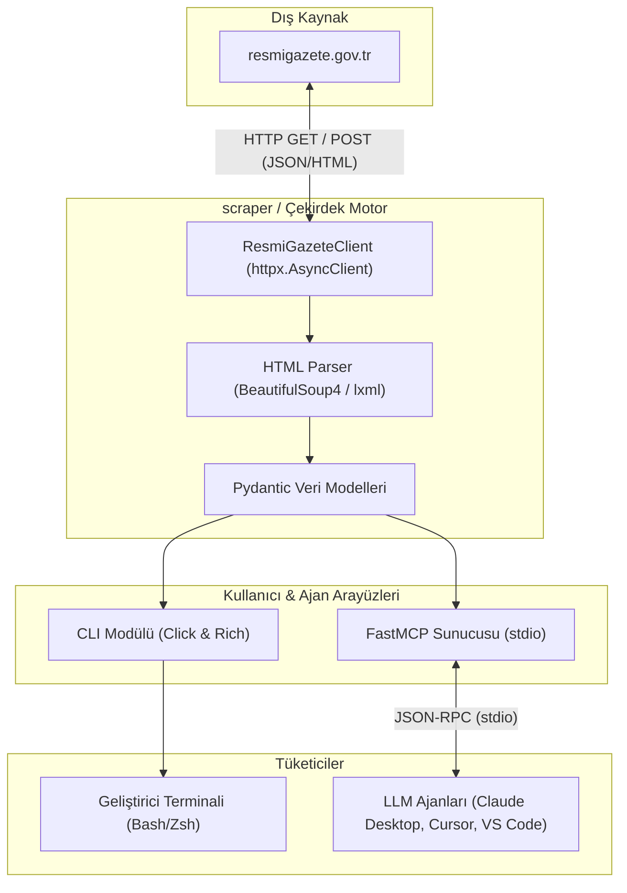

# Resmi Gazete CLI & MCP Dokümantasyonu

[← Ana Dokümantasyona Dön (README.md)](../README.md)

T.C. Resmî Gazete (`resmigazete.gov.tr`) üzerinde yayımlanan kanun, karar, yönetmelik, tebliğ ve yargı kararlarını programatik olarak taramak, terminal üzerinden sorgulamak ve LLM ajanları (Claude Desktop, Cursor, VS Code) ile entegre etmek için geliştirilmiş yüksek performanslı geliştirici araç setidir.

---

## Dokümantasyon Haritası

- [CLI Kullanım Kılavuzu](cli.md): `daily` ve `search` komutları, filtreleme parametreleri, tablo/JSON/Markdown çıktı formatları.
- [Model Context Protocol (MCP) Kılavuzu](mcp.md): FastMCP stdio sunucusu, araç tanımları (`tools`) ve LLM istemci yapılandırmaları.
- [Python SDK ve API Referansı](sdk.md): `ResmiGazeteClient` sınıfı, Pydantic veri modelleri, hata hiyerarşisi ve asenkron kod örnekleri.

---

## Sistem Mimarisi

`resmi-gazete-cli`, üç ana katmandan oluşan modüler ve ayrık bir mimariye sahiptir:



---

## Temel Yetenekler

| Katman | Sağlanan Yetenekler | Çıktı Türleri |
| --- | --- | --- |
| **CLI** | Günlük gazete listeleme, tarihsel arşiv, parametrik filtreli mevzuat araması. | Rich Tablo, JSON, Markdown |
| **MCP** | 4 adet optimize FastMCP aracı (`get_todays_gazette`, `get_gazette_by_date`, `search_gazette`, `get_document_content`). | LLM Tool Call Yanıtı (JSON / Text) |
| **SDK** | Tam tip güvenli Python 3.10+ async HTTP istemcisi, otomatik bağlantı havuzu ve hata yönetimi. | Pydantic V2 Nesneleri |

---

## Hızlı Başlangıç

Paketi doğrudan [PyPI](https://pypi.org/project/resmi-gazete-cli/) üzerinden yükleyin:

```bash
pip install resmi-gazete-cli
```

Veya izole bir terminal aracı olarak çalıştırmak için:

```bash
uv tool install resmi-gazete-cli
# veya
pipx install resmi-gazete-cli
```

Bugünün Resmî Gazete içeriğini terminalde görüntüleyin:

```bash
resmi-gazete-cli daily
```

FastMCP sunucusunu doğrudan çalıştırarak denetleyin:

```bash
resmi-gazete-mcp
```
