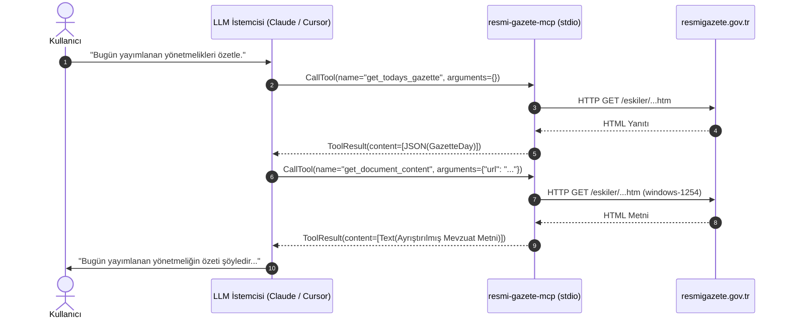

# Model Context Protocol (MCP) Entegrasyon Kılavuzu

[← Dokümantasyon İndeksine Dön](index.md) | [← Ana Dokümantasyon (README.md)](../README.md)

`resmi-gazete-mcp`, Anthropic Model Context Protocol (MCP) standardına tam uyumlu bir sunucu sağlar. LLM tabanlı yapay zeka ajanlarının (Claude Desktop, Cursor IDE, VS Code Continue/Cline) Resmî Gazete içeriğine canlı, deterministik ve doğrulanabilir erişimini mümkün kılar.

---

## İçindekiler

- [Sunucu Mimarisi](#sunucu-mimarisi)
- [Açılan MCP Araçları (Tools)](#açılan-mcp-araçları)
  - [get_todays_gazette](#get_todays_gazette)
  - [get_gazette_by_date](#get_gazette_by_date)
  - [search_gazette](#search_gazette)
  - [get_document_content](#get_document_content)
- [İstemci Yapılandırma Rehberleri](#istemci-yapılandırma-rehberleri)
  - [Claude Desktop](#claude-desktop)
  - [Cursor IDE](#cursor-ide)
  - [VS Code](#vs-code)
- [Örnek Ajan İstek Senaryoları](#örnek-ajan-istek-senaryoları)

---

## Sunucu Mimarisi

Sunucu, Python `mcp` SDK'sı üzerinde `stdio` taşıma katmanını kullanır. LLM istemcisi alt süreç (`subprocess`) olarak `resmi-gazete-mcp` komutunu başlatır ve JSON-RPC ile konuşur.



---

## Açılan MCP Araçları

### get_todays_gazette

Günün Resmî Gazete içeriğini çeker, kategorilere göre düzenlenmiş JSON nesnesi döner.

- **Girdi Parametreleri**: Yok.
- **Dönüş Türü**: `dict` (`GazetteDay` Pydantic modelinin sözlük serileştirmesi).
- **Örnek Çıktı Alanları**: `date`, `number`, `is_mukerrer`, `categories` listesi (başlıklar, madde bağlantıları).

### get_gazette_by_date

Belirtilen geçmiş veya güncel tarihe ait Resmî Gazete sayısını çeker.

- **Girdi Parametreleri**:
  | Parametre | Tip | Zorunlu mu? | Varsayılan | Açıklama |
  | --- | --- | --- | --- | --- |
  | `tarih` | `str` | Evet | - | `GG.AA.YYYY` veya `YYYY-MM-DD` formatında tarih. |
  | `mukerrer` | `bool` | Hayır | `False` | Mükerrer sayıyı sorgulamak için `True` verilir. |
- **Dönüş Türü**: `dict` (`GazetteDay`).

### search_gazette

Resmî Gazete arşivinde anahtar kelime, tarih aralığı ve mevzuat türü filtreleriyle arama yapar.

- **Girdi Parametreleri**:
  | Parametre | Tip | Zorunlu mu? | Varsayılan | Açıklama |
  | --- | --- | --- | --- | --- |
  | `kelime` | `str` | Hayır | `""` | Aranacak kelime veya kavram. |
  | `baslangic_tarihi` | `str` | Hayır | `""` | Başlangıç tarihi (`GG.AA.YYYY` veya `YYYY-MM-DD`). |
  | `bitis_tarihi` | `str` | Hayır | `""` | Bitiş tarihi (`GG.AA.YYYY` veya `YYYY-MM-DD`). |
  | `sayi` | `str` | Hayır | `""` | Resmî Gazete sayısı. |
  | `mevzuat_sayisi` | `str` | Hayır | `""` | Kanun / Yönetmelik numarası. |
  | `mevzuat_turu` | `str` | Hayır | `""` | Tür kodu (`1`: Kanun, `3`: CB Kararı, `4`: Yönetmelik, `5`: Tebliğ vb.). |
  | `mukerrer` | `str` | Hayır | `""` | `1` mükerrer, `0` normal. |
  | `page` | `int` | Hayır | `1` | Sayfa indeksi (1 tabanlı). |
  | `page_size` | `int` | Hayır | `10` | Sayfa başına sonuç limiti. |
- **Dönüş Türü**: `dict` (`SearchResponse` modeli).

### get_document_content

Listeleme veya arama sonucunda elde edilen mevzuat bağlantısının (`url`) tam metnini indirir ve temiz metin olarak döndürür.

- **Girdi Parametreleri**:
  | Parametre | Tip | Zorunlu mu? | Açıklama |
  | --- | --- | --- | --- |
  | `url` | `str` | Evet | Mevzuat belgesinin tam URL adresi. |
- **Özel Davranışlar**:
  - `resmigazete.gov.tr` üzerindeki eski Türkçe HTM belgeleri `windows-1254` karakter setiyle kodlanmıştır; araç karakter kodlamasını otomatik algılar ve Türkçe karakter bozulmasını engeller.
  - HTML script, style ve biçimlendirme etiketlerini temizleyerek LLM bağlam penceresini (token count) optimize eder.
  - URL doğrudan bir PDF dosyasına işaret ediyorsa, PDF ayrıştırma için kullanıcı yönlendirmesi döner.

---

## İstemci Yapılandırma Rehberleri

### Claude Desktop

Yapılandırma dosyanızı açın:
- **macOS**: `~/Library/Application Support/Claude/claude_desktop_config.json`
- **Windows**: `%APPDATA%\Claude\claude_desktop_config.json`
- **Linux**: `~/.config/Claude/claude_desktop_config.json`

Aşağıdaki JSON bloğunu ekleyin (`/path/to/venv` kısmını kendi sanal ortamınızla değiştirin):

```json
{
  "mcpServers": {
    "resmi-gazete": {
      "command": "/path/to/resmi-gazete-cli/.venv/bin/resmi-gazete-mcp",
      "args": []
    }
  }
}
```

### Cursor IDE

Proje dizininizdeki `.cursor/mcp.json` dosyasına ekleyin:

```json
{
  "mcpServers": {
    "resmi-gazete": {
      "command": "/path/to/resmi-gazete-cli/.venv/bin/python",
      "args": ["-m", "resmi_gazete_cli.mcp.server"]
    }
  }
}
```

### VS Code

VS Code Continue eklentisi için `~/.continue/config.json`:

```json
{
  "experimental": {
    "modelContextProtocolServers": [
      {
        "transport": {
          "type": "stdio",
          "command": "/path/to/resmi-gazete-cli/.venv/bin/resmi-gazete-mcp"
        }
      }
    ]
  }
}
```

---

## Örnek Ajan İstek Senaryoları

Ajanınıza aşağıdaki istemleri yönelterek araç kullanımını tetikleyebilirsiniz:

1. **Güncel İnceleme**:
   > "Bugünkü Resmî Gazete'de yayımlanan tebliğleri listele ve vergi mevzuatını ilgilendiren maddeleri 3 maddede özetle."

2. **Tarihsel Arama**:
   > "2024 yılı içerisinde yapay zeka ile ilgili yayımlanmış yönetmelikleri ara ve içeriklerini incele."

3. **Mevzuat İnceleme**:
   > "7524 sayılı Kanunun Resmî Gazete metnini getir ve yürürlük maddelerini çıkar."
